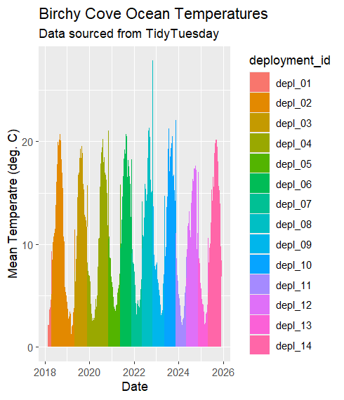
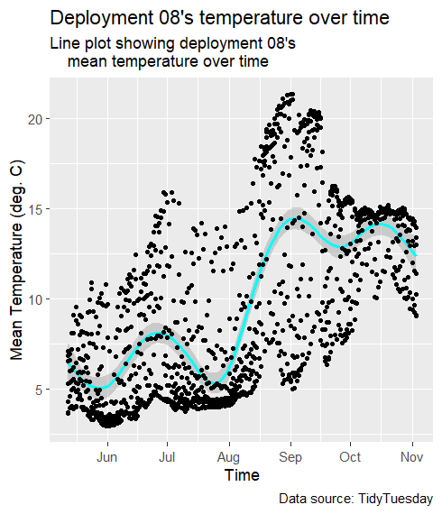
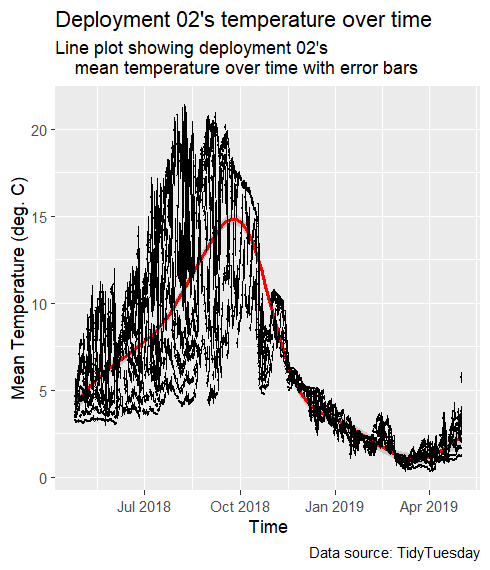

# Assignment #6 - Visualizing Ocean Temperature Data with ggplot2 through 3 plots
# By: Daniel McCartney, Date: November 3, 2026

# In this assignment, I created 3 separate plots in R using ggplot2 to visualize Birchy Cove ocean temperature data. One plot
# looked at mean ocean temperatures across all deployments, while other plots focused on specific deployments.

# For this graph, I added in clear titles to the x and y axes, a title, and a subtitle to the Birchy Cove Ocean Temperatures plot
# that we started in class, showing mean temperature over time across all deployments.

# For this graph, I chose deployment 08.
# I ran into a problem with trying to make a nice looking line plot, since using the geom_line() function made the graph look very
# messy through so many data values, so I instead used the geom_smooth() function from the ggplot2::cheatsheet to create a single
# uniform line across the plot to help with wirth plot visualization.

# For this graph, I chose deployment 02.
# For this graph, I also used the geom_smooth() function for visualization on the plot. I find that error bars representing
# standard deviation values do provide additional useful information, although in the future I would like to find a way to apply
# them in a way that gives a less cluttered appearance to the graph.

# Sources: cheat sheet: Data visualization with ggplot2::cheatsheet - posit.co, data: TidyTuesdayR